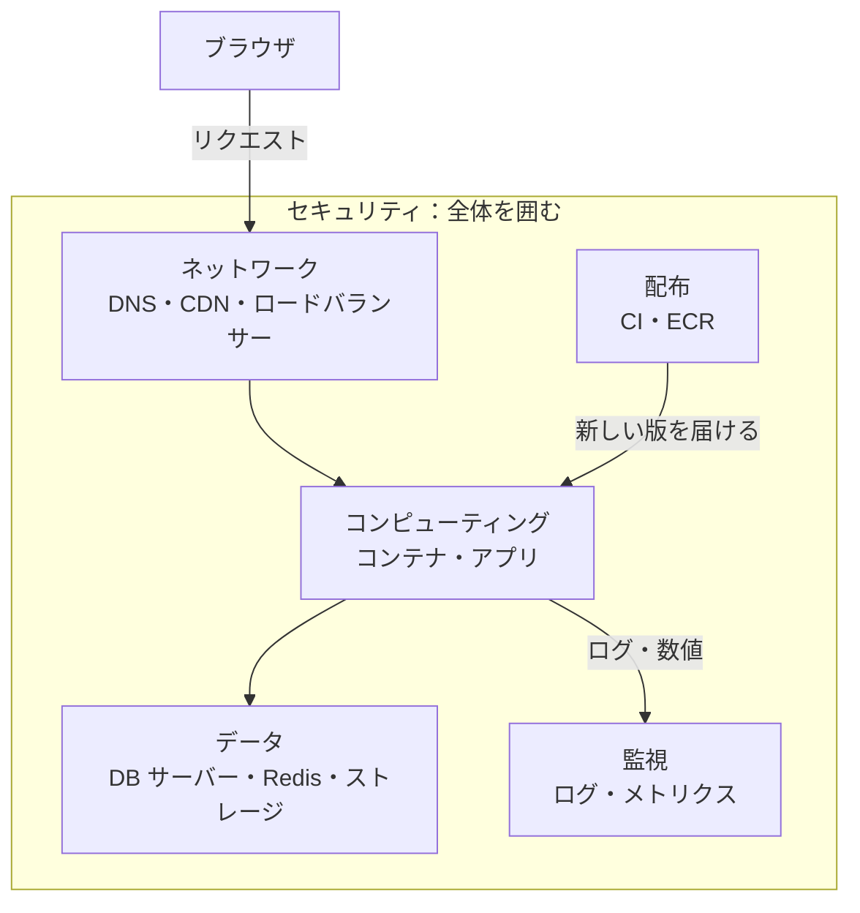

# 全体マップ

迷ったらここから。**いまの場面** を選び、**疑問に近い行** のマップへ進む。
上から順に読むと、構造 → 動き → 障害の調べ方 の順番で学べる。

## 場面から選ぶ

| 場面 | こんな疑問のとき | 図 | 説明ページ | 環境 |
|---|---|---|---|---|
| **理解する** | これはどこにあるの？ | [[オンプレ構成.canvas]] | [[オンプレ構成]] | オンプレ |
| | | [[AWS構成.canvas]] | [[AWS構成]] | AWS |
| | | [[Docker compose構成.excalidraw]] | [[Docker compose構成]] | ローカル |
| | これは何の上で動いてるの？ | [[OSI参照モデルとリクエスト.canvas]] | [[OSI参照モデルとリクエスト]] | 共通 |
| | コンテナは何でできてるの？ | [[コンテナの仕組み.excalidraw]] | [[コンテナの仕組み]] | 共通 |
| **作業する** | リクエストはどう進む？ | [[1リクエストの流れ.canvas]] | [[1リクエストの流れ]] | 共通 |
| | デプロイはどう進む？ | [[デプロイの流れ.canvas]] | [[デプロイの流れ]] | 共通 |
| **困った** | おかしい。どこを見る？ | [[障害の切り分け.canvas]] | [[障害の切り分け]] | 共通 |

- **図**（キャンバスか Excalidraw）：位置関係と流れを見て、解説を開きに行く
- **説明ページ**（Markdown）：図と同じ中身を、表とリンクで持つ。GitHub で見るときや、AI に渡すときはこちら

## マップの決まり

マップと解説の書き方の決まりは [[README]] にまとめている（ここには書かない）。各解説の「前後のつながり」から、その解説が載っているマップへ戻れる。

## 分類 → フォルダ

解説は技術の分類で保管する。

| 分類 | フォルダ | 解説 |
|---|---|---|
| 土台 | `01_基礎` | [[実行モデル]] |
| ネットワーク | `02_ネットワーク` | [[DNS]]、[[CDN]]、[[TLS]]、[[ロードバランサー]]、[[ALB]] |
| コンピューティング | `03_コンピューティング` | [[Nginx]]、[[PHP-FPM]]、[[Goのnet_http]]、[[panicとrecover]]、[[オーケストレーション]]、[[ECS]]、[[グレースフルシャットダウン]] |
| データ | `04_データ` | [[データベースサーバー]]、[[RDS]]、[[接続プール]]、[[N+1問題]] |
| 配布 | `05_配布` | [[CI]]、[[コンテナレジストリ]]、[[ECR]]、[[DBマイグレーション]]、[[ローリング更新]]、[[ロールバック判断]] |
| 監視 | `06_監視` | [[ヘルスチェック]] |
| セキュリティ | `07_セキュリティ` | （追加予定）IAM |

## これから書く解説

マップには載っているが、まだ書いていない解説。書いたら、ここから外して上の「分類 → フォルダ」の表に移す。

| 解説 | 載っているマップ |
|---|---|
| [[コンテナのネットワーク]] | [[Docker compose構成]] |
| [[ボリューム]] | [[Docker compose構成]]、[[コンテナの仕組み]] |
| [[名前空間]] | [[コンテナの仕組み]] |
| [[cgroups]] | [[コンテナの仕組み]] |
| [[コンテナのファイルシステム]] | [[コンテナの仕組み]] |
| [[コンテナの権限]] | [[コンテナの仕組み]] |
| [[コンテナイメージ]] | [[コンテナの仕組み]] |
| [[コンテナランタイム]] | [[コンテナの仕組み]] |
| [[コンテナのライフサイクル]] | [[コンテナの仕組み]] |
