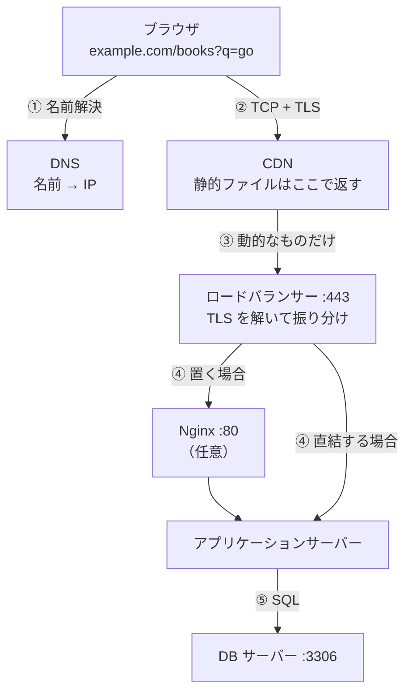

# 1リクエストの流れ

ユーザーが URL を開いてからレスポンスが返るまでに、何がどの順番で起きるかを示すマップ。
図：[[1リクエストの流れ.canvas]]

## 全体図

結果は同じ道を逆にたどってブラウザへ戻る。

## 順番と解説

| 順番 | すること | 受けるもの : ポート | 解説 |
|---|---|---|---|
| ① | 名前を IP アドレスに変換する | DNS サーバー : 53 | [[DNS]] |
| ② | 暗号化した接続を張る | CDN / ロードバランサー : 443 | [[TLS]] |
| ③ | 静的ファイルを返す | CDN のエッジ | [[CDN]] |
| ④ | アプリへ振り分ける | ロードバランサー : 443 | [[ロードバランサー]] |
| ④ | HTTP を受けてアプリへ渡す（任意） | Nginx : 80 | [[Nginx]] |
| ④ | コードを実行する | アプリケーションサーバー | [[実行モデル]] |
| ⑤ | データを読み書きする | DB サーバー : 3306 | [[接続プール]]、[[データベースサーバー]]、[[N+1問題]] |

## あわせて見るマップ

- 各部品が、どの層の話か → [[OSI参照モデルとリクエスト]]
- 各部品が、どこに置かれているか → [[オンプレ構成]]、[[AWS構成]]
- 症状から、どこを疑えばよいか → [[障害の切り分け]]
