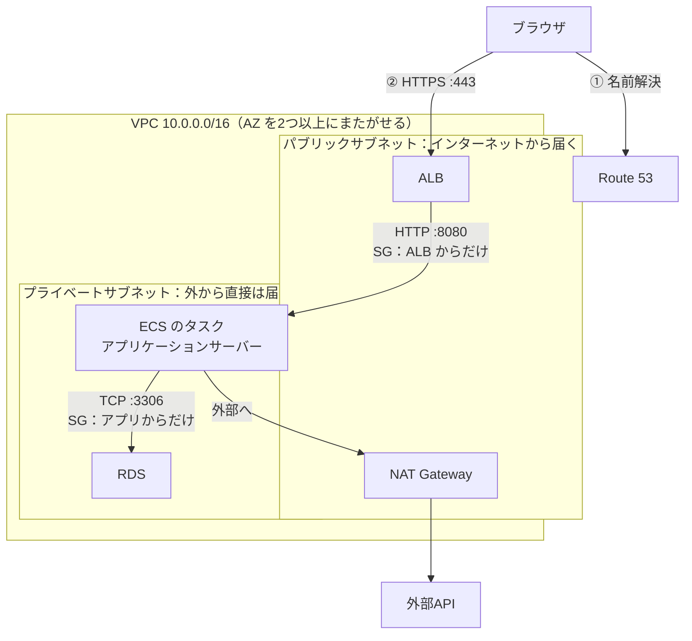

# AWS構成

AWS では、どの部品がどこに置かれ、どこで通信を制限しているかを示すマップ。
図：[[AWS構成.canvas]]

## 全体図

## 置き場所と解説

| 部品 | 置き場所 | すること | 解説 |
|---|---|---|---|
| Route 53 | AWS 全体 | 名前を ALB に向ける | [[DNS]] |
| ALB | パブリックサブネット | 443 で受けて、タスクへ転送する | [[ALB]] |
| ECS のタスク | プライベートサブネット | アプリを動かし、数を保つ | [[ECS]] |
| アプリケーションサーバー | ECS のタスクの中 | リクエストを受けて、コードを実行する | [[実行モデル]] |
| 接続プール | ECS のタスクの中 | RDS への接続を作り置きして、使い回す | [[接続プール]] |
| RDS | プライベートサブネット | データを保存する | [[RDS]] |
| ECR | AWS 全体 | タスクが起動するときにイメージを取得する | [[ECR]] |
| NAT Gateway | パブリックサブネット | プライベートサブネットから外へ出る出口 | |

## 通信の制限

| どこからどこへ | 通すもの | 制限する仕組み |
|---|---|---|
| インターネット → ALB | 443 だけ | ALB のセキュリティグループ |
| ALB → タスク | アプリのポートだけ、ALB からだけ | タスクのセキュリティグループ |
| タスク → RDS | 3306 だけ、タスクからだけ | RDS のセキュリティグループ |
| プライベートサブネット → 外 | 中から始めた通信だけ | NAT Gateway とルートテーブル |

## あわせて見るマップ

- 同じ構成をオンプレで組むとどうなるか → [[オンプレ構成]]
- 手元で docker compose で組むとどうなるか → [[Docker compose構成]]
- リクエストがどの順番で進むか → [[1リクエストの流れ]]
