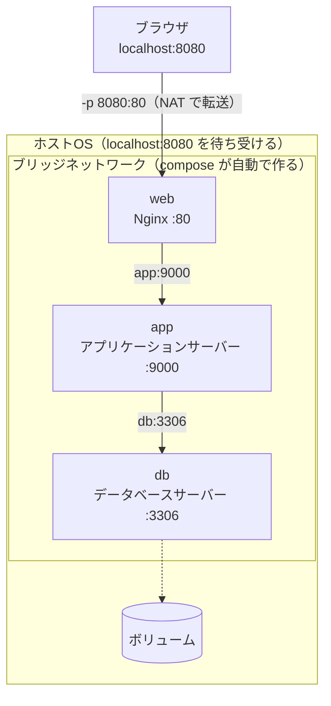

# Docker compose構成

ローカルで docker compose を使うとき、各サービスがどこに置かれ、どこで通信を制限しているかを示すマップ。
図：[[Docker compose構成.excalidraw]]

## 全体図

## 置き場所と解説

| 部品 | 置き場所 | すること | 解説 |
|---|---|---|---|
| ブラウザ | ホストOSの外 | localhost:8080 に接続する | |
| web | ブリッジネットワーク | :80 で HTTP を受け、app:9000 へ渡す | [[Nginx]] |
| app | ブリッジネットワーク | :9000 で受け、アプリのコードを実行する | [[実行モデル]] |
| db | ブリッジネットワーク | :3306 で受け、SQL を実行して保存する | [[データベースサーバー]] |
| ブリッジネットワーク | ホストOS | compose が自動で作り、サービスどうしをつなぐ | [[コンテナのネットワーク]] |
| 内部 DNS | ブリッジネットワーク | サービス名（web・app・db）を IP に変える | [[DNS]] |
| ボリューム | ホストOS（Docker が管理） | db のデータをコンテナの外に残す | [[ボリューム]] |

## 通信の制限

| どこからどこへ | 通すもの | 制限する仕組み |
|---|---|---|
| ブラウザ → web | ホストの 8080 だけ（コンテナの 80 へ転送） | ポート公開（`-p 8080:80` / `ports:`） |
| web → app | 9000 | 同じネットワークの中なので、公開しなくても届く |
| app → db | 3306 | 同じネットワークの中なので、公開しなくても届く |
| ホストの外 → db | 届かない | 3306 を公開しない |

## 間違えやすいこと

| 間違い | 正しくは |
|---|---|
| app から `localhost:3306` で db に接続する | コンテナの中の localhost はそのコンテナ自身。`db:3306` と書く |
| 接続先を IP で書く | IP はコンテナを作り直すと変わる。サービス名で書く（`DB_HOST=db`） |

## あわせて見るマップ

- コンテナの中で何が分けられているか → [[コンテナの仕組み]]
- 同じ構成を本番で組むとどうなるか → [[オンプレ構成]]、[[AWS構成]]
- リクエストがどの順番で進むか → [[1リクエストの流れ]]
