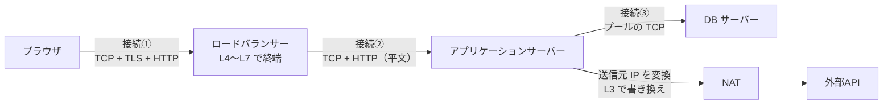

# OSI参照モデルとリクエスト

1リクエストの各部品が、OSI 参照モデルのどの層で何をしているかを示すマップ。
図：[[OSI参照モデルとリクエスト.canvas]]

## 全体図

## 層の一覧

| 層 | 名前 | 扱うもの |
|---|---|---|
| L7 | アプリケーション | HTTP、SQL、DNS の問い合わせ |
| L6 | プレゼンテーション | 暗号化（TLS） |
| L4 | トランスポート | TCP の接続、ポート番号 |
| L3 | ネットワーク | IP アドレス、経路 |

## 層と解説

| 部品・処理 | 層 | すること | 解説 |
|---|---|---|---|
| 名前解決 | L7（結果は L3 で使う） | 名前を IP アドレスに変換する | [[DNS]] |
| TCP 接続 | L4 | 3-way handshake で接続を張る | |
| 暗号化 | L6 | 鍵を交換し、以降を暗号化する | [[TLS]] |
| 通信の許可 | L3 / L4 | IP とポートで、通すか決める | |
| ロードバランサー | L4〜L7 で **終端** | 接続①を終わらせ、接続②を張り直す | [[ロードバランサー]] |
| アプリケーションサーバー | L7 | HTTP を読んで、コードを実行する | [[実行モデル]] |
| DB 接続 | L4〜L7 | プールから接続を借りて SQL を送る | [[接続プール]] |
| NAT | L3 で **書き換え** | 送信元の IP アドレスを変換して外へ出す | |

## あわせて見るマップ

- 各部品が、どこに置かれているか → [[オンプレ構成]]、[[AWS構成]]
- 症状から、どこを疑えばよいか → [[障害の切り分け]]
