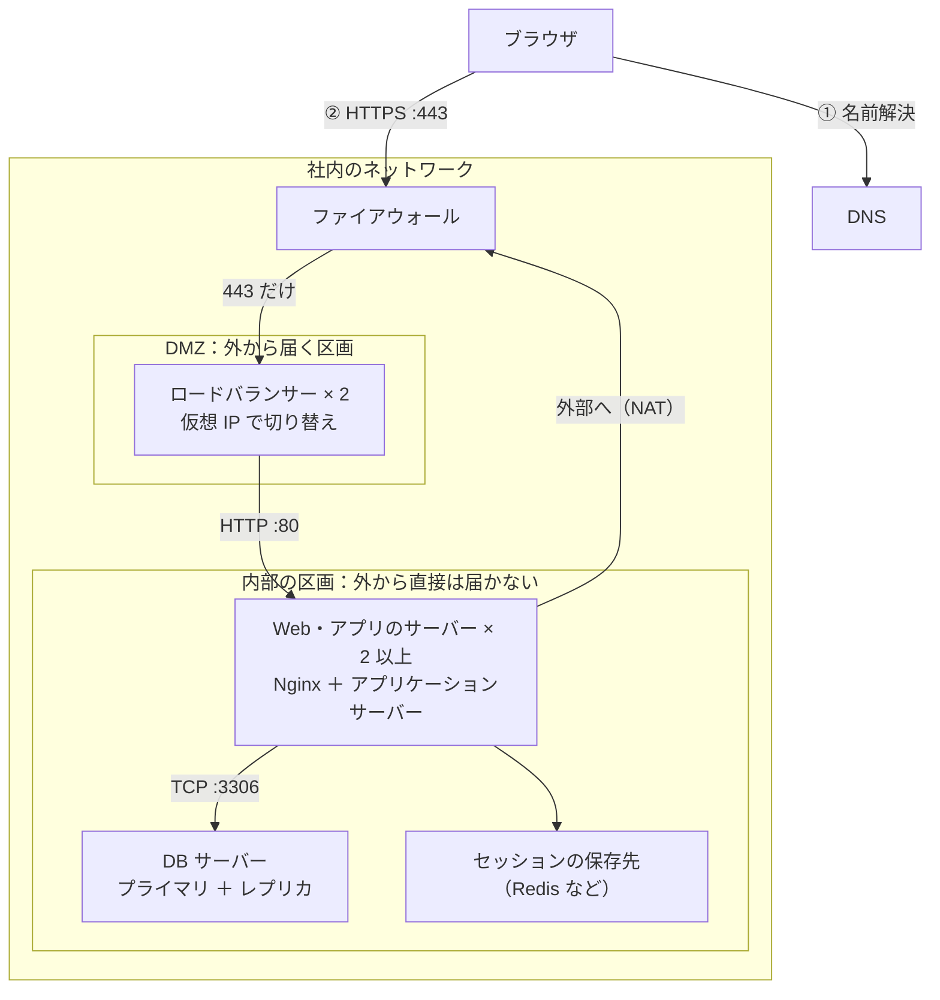

# オンプレ構成

自分たちのサーバーで組むとき、どの部品がどこに置かれ、どこで通信を制限しているかを示すマップ。
図：[[オンプレ構成.canvas]]

## 全体図

## 置き場所と解説

| 部品 | 置き場所 | すること | 解説 |
|---|---|---|---|
| DNS | 社外（契約している DNS サービスなど） | 名前をファイアウォールの公開 IP に向ける | [[DNS]] |
| ファイアウォール | 社内のネットワークの入口 | 外からは 443 だけを通す。中から外へは送信元 IP を変換して出す | |
| ロードバランサー | DMZ | 443 で受けて TLS を解き、Web・アプリのサーバーへ転送する。2台を仮想 IP で切り替える | [[ロードバランサー]]、[[TLS]] |
| Nginx | Web・アプリのサーバー | HTTP を受け、アプリへ渡す | [[Nginx]] |
| アプリケーションサーバー | Web・アプリのサーバー | コードを実行する | [[実行モデル]] |
| systemd | Web・アプリのサーバー | 落ちたプロセスを起動し直す | [[オーケストレーション]] |
| DB サーバー | 内部の区画 | データを保存する。複製を持ち、止まったら切り替える | [[データベースサーバー]]、[[接続プール]] |
| セッションの保存先 | 内部の区画 | どのサーバーに届いても同じセッションを読めるようにする | [[ロードバランサー]] |

## 通信の制限

| どこからどこへ | 通すもの | 制限する仕組み |
|---|---|---|
| インターネット → DMZ | 443 だけ | ファイアウォール |
| DMZ → 内部 | ロードバランサーから Web・アプリのサーバーへの 80 だけ | ファイアウォール、各サーバーの iptables など |
| Web・アプリのサーバー → DB | 3306 だけ | DB サーバーの iptables、MySQL のユーザーの接続元の制限 |
| 内部 → 外 | 中から始めた通信だけ | ファイアウォールの NAT |

## AWS 構成との対応

| オンプレ | AWS |
|---|---|
| ファイアウォール、区画（DMZ・内部） | VPC、サブネット、セキュリティグループ |
| ロードバランサー × 2 ＋ 仮想 IP | ALB（AWS が複数の AZ に置く） |
| Web・アプリのサーバー ＋ systemd | ECS のタスク |
| DB サーバー（プライマリ ＋ レプリカ） | RDS（マルチ AZ、リードレプリカ） |
| ファイアウォールの NAT | NAT Gateway |

## あわせて見るマップ

- 同じ構成を AWS で組むとどうなるか → [[AWS構成]]
- リクエストがどの順番で進むか → [[1リクエストの流れ]]
