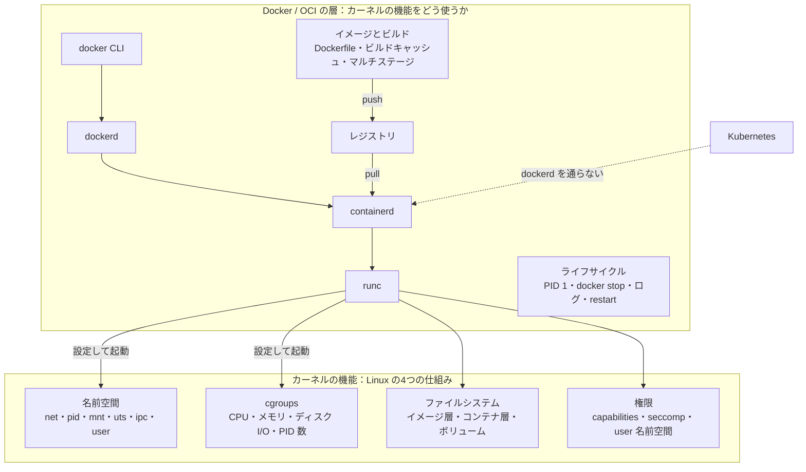

# コンテナの仕組み

コンテナが、Linux カーネルのどの機能の上に、どの部品で作られているかを示すマップ。
図：[[コンテナの仕組み.excalidraw]]

## 全体図

## 層と解説

| 層 | 部品 | すること | 解説 |
|---|---|---|---|
| カーネル | 名前空間 | プロセスから見える範囲（ネットワーク・プロセス番号・ファイルツリーなど）を分ける | [[名前空間]] |
| カーネル | cgroups | CPU 時間・メモリ量・ディスク I/O・PID 数に上限をかける | [[cgroups]] |
| カーネル | ファイルシステム | 読み取り専用のイメージ層に、書き込めるコンテナ層を重ねる | [[コンテナのファイルシステム]] |
| カーネル | ボリューム | Docker が管理し、コンテナを消しても残る保存先 | [[ボリューム]] |
| カーネル | 権限 | capabilities・seccomp・user 名前空間で、root の力を必要な分だけ渡す | [[コンテナの権限]] |
| Docker / OCI | イメージ | Dockerfile の1命令を1つの層にして積み、配布する | [[コンテナイメージ]] |
| Docker / OCI | レジストリ | イメージを置いて配布する | [[コンテナレジストリ]] |
| Docker / OCI | ランタイム | docker CLI → dockerd → containerd → runc の順に渡し、runc が起動する | [[コンテナランタイム]] |
| Docker / OCI | ライフサイクル | PID 1 が終わるとコンテナも止まる。ログは標準出力に出す | [[コンテナのライフサイクル]] |
| Docker / OCI | 停止 | docker stop は SIGTERM を送り、10秒で止まらなければ SIGKILL | [[グレースフルシャットダウン]] |
| 上に載るもの | Kubernetes | dockerd を通らず、containerd を直接使う | [[オーケストレーション]] |

## 実体の場所

| 仕組み | ホストで見える場所 |
|---|---|
| 名前空間 | `/proc/<pid>/ns/` に net・pid などが並ぶ |
| cgroups | `/sys/fs/cgroup/` 以下の設定ファイル |
| ファイルシステム | `/var/lib/docker/` 以下（overlay2・volumes） |
| 権限 | コンテナはホストとカーネルを共有している（だから権限を絞る） |

## 困りごとと見る層

| 困りごと | 見る層 |
|---|---|
| ビルドが遅い・イメージが大きい | イメージとビルド（[[コンテナイメージ]]） |
| 止まらない・ログが出ない | ライフサイクル（[[コンテナのライフサイクル]]） |
| メモリ不足で落ちる（OOM Kill） | cgroups（[[cgroups]]） |
| コンテナを消したらデータも消えた | ファイルシステム（[[ボリューム]]） |

## あわせて見るマップ

- 名前空間の net が、compose でどう使われるか → [[Docker compose構成]]
- 新しいイメージが、どの順番で本番に届くか → [[デプロイの流れ]]
- 通信の部品が、どの層で動くか → [[OSI参照モデルとリクエスト]]
