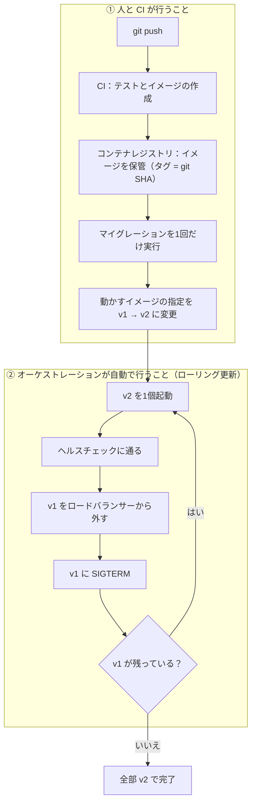

# デプロイの流れ

コードを push してから、本番が新しい版に入れ替わるまでに、何がどの順番で起きるかを示すマップ。
図：[[デプロイの流れ.canvas]]

## 全体図

## 順番と解説

| 順番 | 段階 | すること | 解説 |
|---|---|---|---|
| ① | ビルド | push ごとにテストし、イメージを作る | [[CI]] |
| ② | 保管 | イメージを git SHA のタグで置く | [[コンテナレジストリ]] |
| ③ | DB の変更 | テーブル構造の変更を1回だけ流す | [[DBマイグレーション]] |
| ④ | 指定の変更 | 「このイメージを何個」を書き換える | [[オーケストレーション]] |
| ⑤ | 入れ替え | 新旧を少しずつ入れ替える | [[ローリング更新]] |
| ⑥ | 生存確認 | 新しい版が正常か確かめる | [[ヘルスチェック]] |
| ⑦ | 旧版の終了 | 処理中を終えてから止める | [[グレースフルシャットダウン]] |
| ⑧ | 問題が出たら | 戻すか、直して進むか | [[ロールバック判断]] |

## あわせて見るマップ

- 入れ替わる部品が、どこに置かれているか → [[オンプレ構成]]、[[AWS構成]]
- デプロイの後の障害で、どこを疑えばよいか → [[障害の切り分け]]
