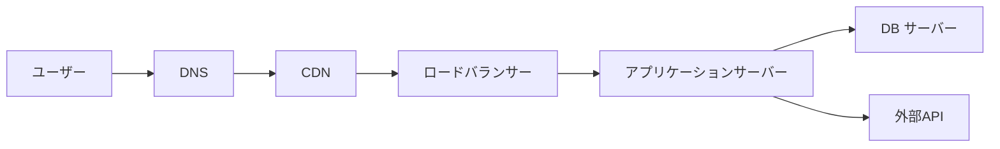

# 障害の切り分け

症状から、どこを疑えばよいかを示すマップ。
図：[[障害の切り分け.canvas]]

## 全体図

症状が出ている場所を特定してから、この図を手前から順にたどる。

## 調べる順番

| # | やること |
|---|---|
| 1 | 影響範囲をつかむ（全員か、一部か、特定の機能か） |
| 2 | メトリクスで、異常が出ている場所を見つける |
| 3 | ログで原因を掘る |
| 4 | 仮説を1つずつ確かめる（同時に複数を変えない） |

## 症状と解説

| 症状 | 最初に疑う場所 | 確かめること | 解説 |
|---|---|---|---|
| アプリは正常なのに繋がらない | DNS | 名前解決できているか、TTL の切り替え中ではないか | [[DNS]] |
| ブラウザが証明書の警告を出す | TLS | 証明書の期限、ドメイン名との一致 | [[TLS]] |
| デプロイしたのに反映されない | CDN | 古いキャッシュが返っていないか | [[CDN]] |
| 502 / 503 / 504 | ロードバランサーとアプリの間 | どのコードかで、ロードバランサーが何に失敗したかが決まる | [[ロードバランサー]] |
| 時々 502 | アプリのプロセス | 落ちては起動し直していないか（停止の理由、起動時刻） | [[オーケストレーション]] |
| デプロイのときだけ 502 | 旧版の止め方 | 処理中のリクエストを切っていないか | [[グレースフルシャットダウン]] |
| 全体が遅い | DB | スロークエリ、クエリの回数 | [[データベースサーバー]]、[[N+1問題]] |
| `Too many connections` | アプリ側の接続数 | 接続数 × 台数が DB の上限を超えていないか | [[接続プール]] |
| DB に `connection refused` / タイムアウト | 経路 | ファイアウォール、ネットワークの区画 | [[データベースサーバー]] |
| 時々ログアウトされる | セッションの置き場所 | サーバーの中にセッションを持っていないか | [[ロードバランサー]] |

## あわせて見るマップ

- 各部品が、どの層の話か → [[OSI参照モデルとリクエスト]]
- 各部品が、どこに置かれているか → [[オンプレ構成]]、[[AWS構成]]
- デプロイの直後に何が起きているか → [[デプロイの流れ]]
